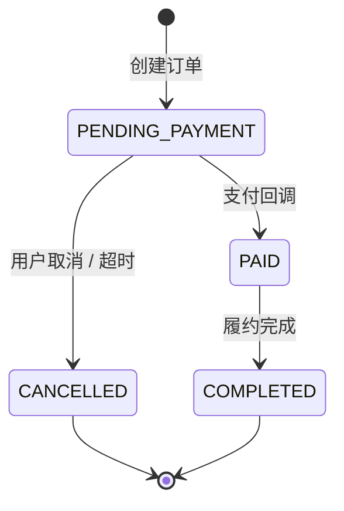
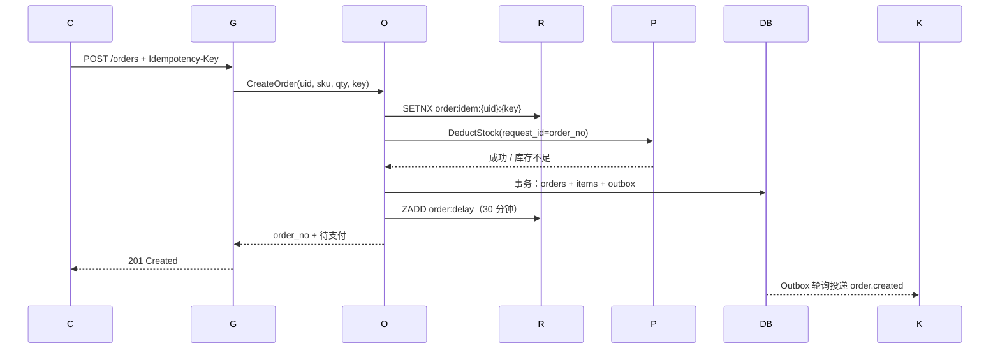

# 04-订单服务与下单主链路
> 一句话定位：把下单拆成幂等、预扣、落库、事件四步，用状态机与补偿把“最终一致”做实。

## 本篇目标

- 画出下单时序与订单状态机，明确每次状态迁移的副作用
- 用幂等令牌 + 唯一索引保证“同一请求只下一单”
- 在本地事务中写 orders / order_items / outbox，避免跨库事务
- 处理预扣失败、超时与未知结果，设计可重放的补偿
- 用 Outbox + Kafka 投递 `order.created`，并实现超时取消与对账

## 前置知识

- 已读 [03-商品与库存服务](03-商品与库存服务.md)，理解 `DeductStock` 与幂等键
- 事务与锁：[09-MySQL与ORM最佳实践/03-事务-乐观锁-软删除](../09-MySQL与ORM/03-事务-乐观锁-软删除.md)
- 可靠消息与幂等：[11-消息队列最佳实践/04-可靠投递-幂等-顺序消息](../11-消息队列/04-可靠投递-幂等-顺序消息.md)

## 一、订单状态机



| 迁移 | 触发 | 副作用 |
| --- | --- | --- |
| 创建 → 待支付 | 下单 | 预扣库存、写 outbox、投延迟任务 |
| 待支付 → 已支付 | 支付回调 | 扣 `locked`、发 `order.paid` |
| 待支付 → 已取消 | 用户/超时 | 回补库存、发 `order.cancelled` |
| 已支付 → 已完成 | 履约 | 只更新状态，不再动库存 |

所有更新都带前置状态：`UPDATE orders SET status=? WHERE order_no=? AND status=?`，影响行数为 0 说明状态已被别人改过，按幂等成功处理，不报 500。

## 二、三张关键表

```sql
CREATE TABLE orders (
  id BIGINT UNSIGNED PRIMARY KEY AUTO_INCREMENT,
  order_no VARCHAR(32) NOT NULL,
  user_id BIGINT UNSIGNED NOT NULL,
  status TINYINT NOT NULL COMMENT '10 待支付 20 已支付 30 已取消 40 已完成',
  total_cent INT NOT NULL,
  idempotency_key VARCHAR(64) NOT NULL,
  expire_at DATETIME(3) NOT NULL,
  created_at DATETIME(3) NOT NULL DEFAULT CURRENT_TIMESTAMP(3),
  updated_at DATETIME(3) NOT NULL DEFAULT CURRENT_TIMESTAMP(3) ON UPDATE CURRENT_TIMESTAMP(3),
  UNIQUE KEY uk_order_no (order_no),
  UNIQUE KEY uk_user_idem (user_id, idempotency_key),
  KEY idx_user_status (user_id, status, id),
  KEY idx_expire (status, expire_at)
);

CREATE TABLE order_items (
  id BIGINT UNSIGNED PRIMARY KEY AUTO_INCREMENT,
  order_id BIGINT UNSIGNED NOT NULL,
  product_id BIGINT UNSIGNED NOT NULL,
  sku_id BIGINT UNSIGNED NOT NULL,
  title_snapshot VARCHAR(128) NOT NULL,
  price_cent INT NOT NULL,
  qty INT NOT NULL,
  KEY idx_order (order_id)
);

CREATE TABLE outbox_events (
  id BIGINT UNSIGNED PRIMARY KEY AUTO_INCREMENT,
  event_id VARCHAR(64) NOT NULL,
  event_type VARCHAR(32) NOT NULL,
  aggregate_id VARCHAR(64) NOT NULL,
  payload JSON NOT NULL,
  status TINYINT NOT NULL DEFAULT 0 COMMENT '0 待投递 1 已投递',
  retry_count INT NOT NULL DEFAULT 0,
  next_retry_at DATETIME(3) NOT NULL DEFAULT CURRENT_TIMESTAMP(3),
  created_at DATETIME(3) NOT NULL DEFAULT CURRENT_TIMESTAMP(3),
  UNIQUE KEY uk_event (event_id),
  KEY idx_poll (status, next_retry_at)
);
```

`order_no` 用“日期 + 用户后四位 + 随机”生成，全局唯一且可读；`idempotency_key` 由网关透传，前端每次点击生成一个。

## 三、下单时序



顺序是刻意的：先占幂等位，再预扣，最后落库。若反过来先落库，预扣失败就要删订单，补偿更难自证。

## 四、幂等令牌

```go
key := fmt.Sprintf("order:idem:%d:%s", uid, idemKey)
ok, err := s.rdb.SetNX(ctx, key, orderNo, 24*time.Hour).Result()
if err != nil {
	return nil, fmt.Errorf("idem guard: %w", err) // 降级：靠 DB 唯一键
}
if !ok {
	return s.repo.FindByIdempotencyKey(ctx, uid, idemKey) // 返回首次订单
}
```

Redis 只挡重复，最终靠 `uk_user_idem`。并发穿透时 `Create` 返回 `gorm.ErrDuplicatedKey`，此时查回已有订单并返回 200，语义是“这次请求成功，订单就是那一单”。幂等键必须有 TTL，但 DB 唯一键永久保留。

## 五、创建订单的本地事务

```go
err := s.db.WithContext(ctx).Transaction(func(tx *gorm.DB) error {
	if err := tx.Create(order).Error; err != nil {
		return err
	}
	if err := tx.Create(&items).Error; err != nil {
		return err
	}
	return outbox.Append(tx, "order.created", order.OrderNo, eventPayload(order, items))
})
if err != nil {
	s.compensate(ctx, order.OrderNo) // 回补库存，见下一节
	return nil, err
}
```

事务内只做本地写，**绝不包 RPC 和 Kafka 发送**。Outbox 与业务同库同事务，是“消息一定发得出去”的唯一可靠写法。

## 六、预扣失败与补偿

| 场景 | 处理 |
| --- | --- |
| `DeductStock` 明确返回库存不足 | 直接返回 20002，不创建订单，幂等键保留 10 分钟供重试 |
| 预扣超时（未知结果） | 用同一 `request_id` 重试查询/扣减，禁止换键重试 |
| 预扣成功、本地事务失败 | 调 `RestoreStock(request_id+":restore")`，失败写补偿表由 Job 重放 |
| 落库成功、Outbox 投递失败 | 不改订单状态，Outbox 按退避重试，消费者幂等 |

补偿表记 `order_no、动作、重试次数、下次执行时间`，Job 用 `FOR UPDATE SKIP LOCKED` 捞任务，保证多实例不重复执行。补偿只认幂等键，执行多次结果一致。

## 七、Kafka 事件与 Outbox

```go
rows, _ := tx.Raw(`SELECT id, event_id, event_type, payload FROM outbox_events
  WHERE status = 0 AND next_retry_at <= NOW(3)
  ORDER BY id LIMIT 100 FOR UPDATE SKIP LOCKED`).Rows()
for rows.Next() {
	// 发送 Kafka：key = aggregate_id，保证同一订单进同一分区
	if err := writer.WriteMessages(ctx, kafka.Message{
		Topic: "order-events", Key: []byte(aggregateID), Value: payload,
	}); err != nil {
		tx.Exec(`UPDATE outbox_events SET retry_count = retry_count + 1,
		  next_retry_at = DATE_ADD(NOW(3), INTERVAL LEAST(POW(2, retry_count), 300) SECOND)
		  WHERE id = ?`, id)
		continue
	}
	tx.Exec(`UPDATE outbox_events SET status = 1 WHERE id = ?`, id)
}
```

事件体包含 `event_id`、`order_no`、`user_id`、`items`、`occurred_at`。消费者按 `event_id` 去重（Redis SETNX 或消费记录表），先落库再提交 offset，保证至少一次语义下不重复扣减。

## 八、超时未支付取消

延迟任务写入 Redis ZSet，`score = expire_at`；调度器每秒取到期订单：

```go
due, _ := rdb.ZRangeByScore(ctx, "order:delay", &redis.ZRangeBy{
	Min: "-inf", Max: strconv.FormatInt(time.Now().Unix(), 10), Count: 200,
}).Result()
for _, orderNo := range due {
	// Lua / 事务：ZREM + 条件更新状态，只有更新成功才回补
	if s.cancelIfPending(ctx, orderNo) {
		_ = s.restoreStock(ctx, orderNo+":restore")
		s.publishCancelled(ctx, orderNo)
	}
}
rdb.ZRem(ctx, "order:delay", due)
```

再加一个每分钟扫 DB 的兜底任务：`WHERE status = 10 AND expire_at < NOW(3) LIMIT 500`，防止 Redis 丢数据。取消与支付并发时，条件更新只有一个能成功，输家直接返回当前状态，不重复回补。

## 九、订单查询：缓存与读写分离

- 详情缓存 `order:detail:{orderNo}`，TTL 10 分钟；状态变更后删除，不更新
- 列表用游标分页 `WHERE user_id = ? AND id < ? ORDER BY id DESC LIMIT 20`，禁止深 offset
- 读副本承接查询，支付/取消后的立即查询可强制走主库（GORM Resolver 的 `Write`）
- 所有查询先校验 `user_id`，越权返回 403 而不是 404 之外的细节

## 十、超时、重试与错误码

- RPC 超时：读 100ms、预扣 300ms、落库 500ms；超时时间必须小于上游 HTTP 超时
- 重试：只对幂等操作自动重试（`GetProduct`、带同一 request_id 的 `DeductStock`）；写操作重试必须复用幂等键
- 熔断：product-service 错误率超 50% 时快速失败，返回 50002，避免线程/连接被拖死
- 错误码：库存不足 20002、重复下单 30003、状态冲突 30002、下游超时 50001

## 十一、一致性验证与对账

每日跑三类校验：已支付订单必须存在对应 `deduct` 流水；已取消订单必须有 `restore` 流水且仅一条；Outbox 待投递数量与最老事件年龄不得超阈值。发现差异先告警再冻结，不自动改数。

```sql
SELECT o.order_no FROM orders o
LEFT JOIN stock_logs l ON l.request_id = o.order_no AND l.type = 'deduct'
WHERE o.status IN (20, 40) AND l.id IS NULL;
```

## 常见坑

1. **事务里发 Kafka**：消息发出但事务回滚，或事务提交但消息丢失；只写 Outbox。
2. **预扣超时就换新 request_id 重试**：可能扣两次；未知结果必须用原键查询或重试。
3. **取消不看前置状态**：支付成功后仍执行取消，库存被错误回补；条件更新是底线。
4. **幂等键只在 Redis**：Redis 淘汰或故障后重复下单；DB 唯一索引不可省。
5. **深分页查订单**：`LIMIT 100000, 20` 拖垮 DB；用游标。
6. **补偿任务无上限**：失败任务无限重试打爆下游；指数退避 + 最大次数 + 人工队列。

## 小结

- 状态机固定四条迁移，每次迁移都带前置状态条件，天然幂等
- 下单顺序：幂等占位 → 预扣 → 本地事务（含 Outbox）→ 延迟任务
- 事务只写本地库，事件靠 Outbox 轮询投递，消费者按 event_id 去重
- 超时取消用 Redis ZSet + DB 扫描双保险，回补与状态更新都幂等
- 查询走缓存 + 游标 + 读写分离，写后立即读要强制主库

## 练习

1. 给 `orders` 加 `paid_at`、`cancelled_at`，写出支付回调的幂等更新 SQL，并说明重复回调的返回。
2. 实现 Outbox 投递器：支持批量、指数退避、`SKIP LOCKED`，并补一个“发送成功但标记失败”的测试。
3. 用 wrk 对同一用户同一 Idempotency-Key 并发 100 次下单，验证只产生一张订单与一条扣减流水。

## 相关章节

- 上一篇：[03-商品与库存服务](03-商品与库存服务.md)
- 下一篇：[05-APISIX网关鉴权与限流](05-APISIX网关鉴权与限流.md)
- [12-微服务与Kratos/01-Gin加Kratos的微服务架构](../12-微服务与Kratos/01-Gin加Kratos的微服务架构.md)
