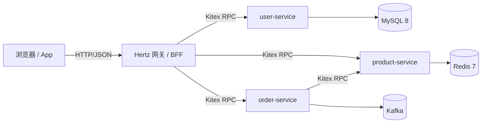
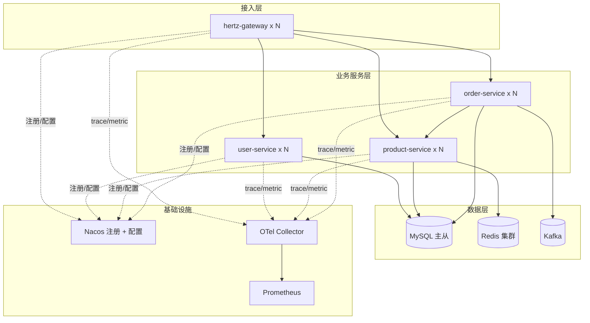
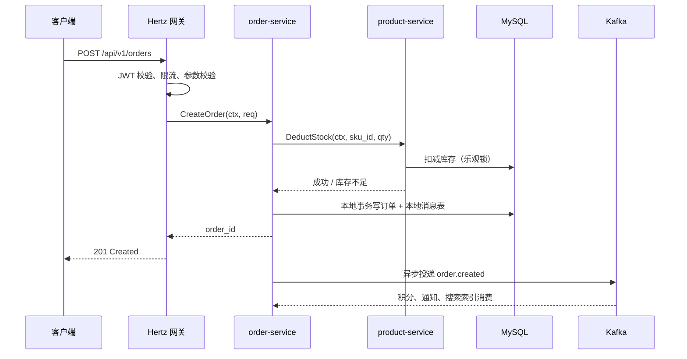

# Hertz 加 Kitex 的微服务架构

> 一句话定位：边缘用 Hertz 接住浏览器和 App，内部用 Kitex 传递强类型 RPC，并用一张部署视图把 mall-lite 的调用链落到工程上。

## 本篇目标

- 说清“为什么边缘 Hertz、内部 Kitex”，而不是全站一个框架
- 量化内部改用 HTTP/JSON 的代价，知道什么规模可以接受
- 认识 CloudWeGo 体系（Hertz / Kitex / Volo / Netpoll）的分工
- 画出 mall-lite 的部署视图与下单调用链
- 掌握 registry / config / observability / middleware 等共享能力的收敛方式
- 理解拆分粒度与边界原则，并知道什么时候不该上微服务

## 前置知识

- 已读 [02-Hertz入门/01-Hertz是什么-架构与性能](../02-Hertz入门/01-Hertz是什么-架构与性能.md)
- 已读 [05-治理与扩展/01-服务注册与发现总览](../05-治理与扩展/01-服务注册与发现总览.md)
- 了解 HTTP、RPC、序列化、注册中心、消息队列的基本概念

## 一、两种流量，两套协议

一个电商系统里实际存在两类完全不同的流量：**南北向**（客户端 → 系统）和**东西向**（服务 → 服务）。它们的最优解不同。

| 维度 | 边缘：Hertz | 内部：Kitex |
| --- | --- | --- |
| 使用方 | 浏览器、App、第三方开放平台 | 服务与服务 |
| 协议 | HTTP/1.1、HTTP/2、SSE | Thrift / Protobuf over TTHeader |
| 载荷 | JSON，人类可读，方便抓包 | 二进制，体积小、编解码快 |
| 契约 | hz 的 IDL 注解 + OpenAPI | Thrift / Protobuf IDL，强类型 |
| 连接 | keep-alive，经 CDN / LB | 长连接 + 多路复用 |
| 治理 | JWT、CORS、限流、聚合、SSE | 超时、重试、熔断、染色、泛化调用 |
| 变更节奏 | 跟随前端发版 | 跟随领域模型演进 |

边缘选择 Hertz 的原因很直接：它是为“面向客户端”设计的——路由树、参数绑定校验、JSON 渲染、中间件、SSE、静态资源、TLS、HTTP 客户端一应俱全，且基于 Netpoll 有更好的吞吐和更低的内存占用。

```go
h := server.Default(server.WithHostPorts(":8080"))
h.Use(jwtAuth(), rateLimit())
api := h.Group("/api/v1")
api.POST("/orders", orderHandler.Create)   // 网关只做鉴权、限流、聚合
api.GET("/products/:id", productHandler.Get)
```

内部选择 Kitex 的原因则是“面向服务”：IDL 生成客户端和服务端桩代码、二进制序列化、长连接多路复用、内置超时/重试/熔断/服务发现，并且同一份 IDL 可以跨语言。

```thrift
namespace go user

struct GetUserReq {
    1: required i64 user_id
}

struct User {
    1: i64 user_id
    2: string nickname
}

service UserService {
    User GetUser(1: GetUserReq req)
}
```

## 二、内部改用 HTTP 的代价

内部全部用 HTTP/JSON 并非不可行，小团队、服务少、跨语言简单时反而更省事。但规模上来后，代价会集中在四处：

| 代价 | 具体表现 | 影响 |
| --- | --- | --- |
| 序列化开销 | JSON 编解码比 Thrift 二进制慢，报文大 2~5 倍 | CPU 与带宽上升，P99 抖动 |
| 连接管理 | HTTP/1.1 需自建连接池，HTTP/2 需处理流控 | 高并发下握手与端口耗尽 |
| 契约漂移 | 手写 struct + 注释约定，字段改名无编译错误 | 联调靠猜，线上 500 |
| 治理缺失 | 超时、重试、熔断、染色要自己写中间件 | 每个团队一套，故障放大 |

一个粗略的量级：单次内部调用 1KB JSON，序列化约几十微秒；QPS 5 万时，仅编解码就可能吃掉数个核。这不是“不能用”，而是“规模到了就不划算”。

判断标准可以很朴素：**服务数 ≤ 5、团队 ≤ 2 个、没有独立扩缩容需求时，内部 HTTP 完全可以接受；一旦需要跨团队契约、灰度、熔断和链路治理，Kitex 的收益开始大于学习成本。**

## 三、CloudWeGo 体系

CloudWeGo 不是单一框架，而是一组可组合的基础设施：

| 项目 | 定位 | mall-lite 中的角色 |
| --- | --- | --- |
| Hertz | 高性能 HTTP 框架 | 网关 / BFF |
| Kitex | 高性能 RPC 框架 | user / product / order 服务 |
| Volo | Rust RPC 框架 | 本教程不涉及，跨语言时可选 |
| Netpoll | 非阻塞网络库 | Hertz / Kitex 的底层 |
| Shmipc | 共享内存 IPC | 同机高性能通信，进阶选型 |



Hertz 与 Kitex 共享 Netpoll 与同一套可观测生态，这是它们能拼在一起的基础；但两者的编程模型不同，**不要把 Hertz 的中间件直接塞进 Kitex**，端上中间件要用 `endpoint.Middleware`（见 [03-Kitex服务端最佳实践](03-Kitex服务端最佳实践.md)）。

## 四、mall-lite 部署视图与调用链



下单主链路（同步只保留必须强一致的部分）：



要点：**同步链路越短越好**。发短信、加积分、更新搜索索引都不该卡住下单，交给 Kafka 做最终一致（详见 [08-分布式事务与最终一致性](08-分布式事务与最终一致性.md)）。

## 五、共享能力放在哪

| 能力 | 收敛位置 | 说明 |
| --- | --- | --- |
| 服务注册 / 发现 | Nacos | Kitex 用 registry-nacos，Hertz 用 hertz-contrib/registry |
| 配置 | Nacos Config | 业务配置与治理配置分离 |
| 链路追踪 | OpenTelemetry | Hertz / Kitex 各接各的 Suite |
| 日志 | hlog / klog + 统一字段 | 必须带 trace_id、uid、tenant |
| 通用中间件 | 内部 `pkg/mw` | recover、访问日志、鉴权、染色 |
| IDL | `idl/` 单仓管理 | 契约先行，生成代码不入手改 |

推荐目录（模块化单体到微服务的同一套骨架）：

```text
mall-lite/
├── idl/                  # thrift / proto 契约
├── kitex_gen/            # kitex 生成，禁止手改
├── pkg/                  # 跨服务共享：errs、mw、obs、config
├── hertz-gateway/
├── user-service/
├── product-service/
└── order-service/
```

共享代码只放“与业务无关”的东西。一旦 `pkg` 里出现 `Order`、`Sku` 这类领域模型，说明边界已经漏了，下一步就是跨服务改代码。

## 六、拆分粒度与边界

三条原则：

1. **按业务能力拆，不按技术层拆**。`controller-service-dao` 各起一个服务是典型反模式，一次请求要跨三个服务，延迟和故障点翻倍。
2. **一个服务拥有一份数据**。其他服务只能通过接口拿数据，禁止直连对方数据库、禁止跨库 join。
3. **先模块化，再服务化**。在单体里用包边界跑通，等出现独立的扩缩容或发布诉求再拆。

| 做法 | 反例 | 正例 |
| --- | --- | --- |
| 拆分依据 | 按 controller / service / dao | 按用户、商品、订单 |
| 数据 | 三个服务共用一个库、随便 join | 每服务独立 schema，接口取数 |
| 调用 | 网关里写业务规则 | 网关只做鉴权、限流、聚合 |
| 事务 | 跨服务强一致 | 本地事务 + 消息 + 补偿 |

mall-lite 的初始拆分：

| 服务 | 数据所有权 | 对外 RPC |
| --- | --- | --- |
| user-service | users、addresses | GetUser、BatchGetUsers、CreateUser |
| product-service | products、skus、stock | GetProduct、DeductStock、ReleaseStock |
| order-service | orders、order_items、outbox | CreateOrder、GetOrder、CancelOrder |

库存先放在 product-service，量级上来、扣减成为独立瓶颈后再拆 inventory-service；拆的时候先加一层接口，再迁数据，不要一次性重写。

## 七、什么时候不该上微服务

- 团队小于 10 人，没人维护注册中心、链路、告警和发布流水线
- 单体部署已能满足容量，扩缩容不是瓶颈
- 各模块没有独立发布节奏，拆了反而每次都要一起发
- 业务流程跨多个模块强一致，分布式事务成本高于收益
- 没有统一日志 / 指标 / trace，出了问题定位不了
- 只是“想学微服务”，没有真实业务驱动

替代方案是**模块化单体**：一个进程、一个库，但包边界清晰、服务间只通过接口调用，并在接口层预留 RPC 化的可能。等真正出现独立扩容、独立团队、独立发布的需求，再把模块“抬”成服务，成本最低。

## 常见坑

1. **网关越来越胖**：把优惠计算、库存判断写进 Hertz handler，最后网关成了第二个单体。
2. **服务间共享数据库**：图省事直连对方表，对方改字段时全线崩溃。
3. **按技术层拆服务**：一次查询跨三个 RPC，P99 翻三倍，还说不清慢在哪。
4. **内部 HTTP 不设超时和熔断**：下游一慢，上游 goroutine 堆积，故障沿调用链放大。
5. **只画架构图不定义数据所有权**：最后还是要跨服务 join，拆分名存实亡。

## 小结

- 边缘 Hertz、内部 Kitex，是按“面向客户端”和“面向服务”两种流量做的分工
- 内部 HTTP 的代价主要在序列化、连接、契约和治理，规模小可以接受
- CloudWeGo 的 Hertz / Kitex / Volo 共享 Netpoll 与可观测生态，但中间件模型不同
- 同步链路只保留强一致步骤，通知类动作交给 Kafka 做最终一致
- 拆分按业务能力与数据所有权，先模块化后服务化，能不上微服务就不上

## 练习

1. 给 mall-lite 画一版包含 Nacos、Kafka、OTel 的部署图，标出每个服务的数据库。
2. 估算：内部调用 2 万 QPS、平均 2KB JSON，改成 Thrift 后带宽和 CPU 大致省多少？
3. 找出你现有项目里“网关写了业务逻辑”的三处代码，说明应该下沉到哪个服务。

## 官方文档

- Hertz 概览：<https://www.cloudwego.io/zh/docs/hertz/overview/>
- Kitex 概览：<https://www.cloudwego.io/zh/docs/kitex/overview/>
- CloudWeGo 官网：<https://www.cloudwego.io/zh/>
- Netpoll：<https://github.com/cloudwego/netpoll>
