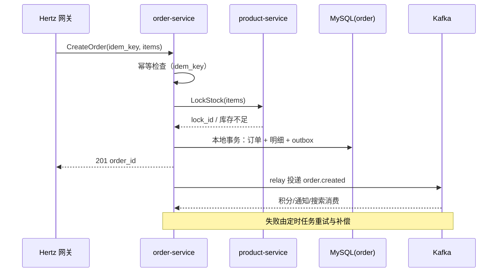

# 分布式事务与最终一致性

> 一句话定位：下单链路不追求“跨服务强一致”，而是用本地事务 + 本地消息表 + Kafka + 幂等消费 + 定时补偿，把一致性做成可观测、可修复的工程问题。

## 本篇目标

- 对比 2PC / TCC / Saga / 本地消息表 / 事务消息的适用边界
- 建立“能不用分布式事务就不用”的判断标准
- 落地 mall-lite 下单：订单本地事务 + outbox + Kafka 投递
- 设计消费端幂等、库存预扣与失败补偿
- 写对账与定时修复任务，定义幂等键
- 用 Saga 编排处理跨服务长流程，并配套监控告警

## 前置知识

- 已读 [04-Kitex客户端与Hertz集成](04-Kitex客户端与Hertz集成.md)
- 已读 [11-消息队列/02-Kafka生产与消费实践](../11-消息队列/02-Kafka生产与消费实践.md)
- 了解 GORM 事务、MySQL 唯一索引、Kafka 至少一次语义

## 一、五种方案对比

| 方案 | 一致性 | 侵入性 | 性能 | 适用边界 |
| --- | --- | --- | --- | --- |
| 2PC / XA | 强一致 | 高，依赖数据库 | 差，锁持有久 | 极少，传统金融内部 |
| TCC | 最终一致 | 高，每步写 Try/Confirm/Cancel | 好 | 资金、库存等需精确控制的场景 |
| Saga | 最终一致 | 中，需补偿逻辑 | 好 | 长流程、跨多个服务 |
| 本地消息表 | 最终一致 | 低，业务库多一张表 | 好 | 订单、通知等大多数场景 |
| 事务消息 | 最终一致 | 中，依赖 MQ 支持 | 好 | 已有 RocketMQ 等支持事务消息的团队 |

结论先行：**能不分布式事务就不做**。优先合并服务、调整边界、把跨服务写改成“一个服务写 + 异步通知”，实在避不开才选方案。mall-lite 选本地消息表，因为它不绑定特定 MQ、可读可查、补偿简单。

## 二、下单链路编排



关键取舍：**库存预扣是同步的**（用户要立刻知道有没有货），积分、通知、索引是异步的（允许秒级延迟）。同步链路越短，不一致窗口越小。

## 三、本地消息表

```sql
CREATE TABLE order_outbox (
  id            BIGINT UNSIGNED AUTO_INCREMENT PRIMARY KEY,
  event_id      CHAR(36)     NOT NULL,
  topic         VARCHAR(64)  NOT NULL,
  payload       JSON         NOT NULL,
  status        TINYINT      NOT NULL DEFAULT 0, -- 0 待投递 1 已投递 2 死信
  retry_count   INT          NOT NULL DEFAULT 0,
  next_retry_at DATETIME(3)  NOT NULL DEFAULT CURRENT_TIMESTAMP(3),
  created_at    DATETIME(3)  NOT NULL DEFAULT CURRENT_TIMESTAMP(3),
  UNIQUE KEY uk_event_id (event_id),
  KEY idx_status_retry (status, next_retry_at)
) ENGINE=InnoDB;
```

订单与消息在**同一个本地事务**里落库，彻底避免“订单成功、消息丢失”：

```go
err := db.Transaction(func(tx *gorm.DB) error {
    if err := tx.Create(&order).Error; err != nil {
        return err
    }
    payload, _ := json.Marshal(OrderCreatedEvent{EventID: eventID, OrderID: order.ID,
        UserID: order.UserID, TraceID: traceID, OccurredAt: time.Now().UnixMilli()})
    return tx.Create(&OrderOutbox{
        EventID: eventID, Topic: "order.created",
        Payload: string(payload), Status: 0,
    }).Error
})
```

## 四、可靠投递与幂等消费

relay 任务扫描待投递消息，成功才置为已投递：

```go
for {
    var rows []OrderOutbox
    db.Clauses(clause.Locking{Strength: "UPDATE", Options: "SKIP LOCKED"}).
        Where("status = 0 AND next_retry_at <= ?", time.Now()).
        Order("id").Limit(100).Find(&rows)

    for _, row := range rows {
        err := writer.WriteMessages(ctx, kafka.Message{
            Topic: row.Topic, Key: []byte(row.EventID), Value: []byte(row.Payload),
        })
        if err != nil {
            backoff := time.Duration(1<<min(row.RetryCount, 6)) * time.Second
            db.Model(&row).Updates(map[string]interface{}{
                "retry_count":   gorm.Expr("retry_count + 1"),
                "next_retry_at": time.Now().Add(backoff),
            })
            continue
        }
        db.Model(&row).Update("status", 1)
    }
    time.Sleep(time.Second)
}
```

`SKIP LOCKED` 让多实例 relay 不互相阻塞；也可以用分布式锁，但多一层依赖。

Kafka 是至少一次，消费端必须幂等：

```go
// 快速预检：Redis SETNX 命中说明已处理
ok, _ := rdb.SetNX(ctx, "idem:"+event.EventID, 1, 24*time.Hour).Result()
if !ok {
    return nil
}

// 最终保证：与业务变更同事务写唯一键
err := db.Transaction(func(tx *gorm.DB) error {
    if err := tx.Create(&ConsumedEvent{EventID: event.EventID}).Error; err != nil {
        if errors.Is(err, gorm.ErrDuplicatedKey) {
            return nil
        }
        return err
    }
    return tx.Model(&User{}).Where("id = ?", event.UserID).
        Update("points", gorm.Expr("points + ?", event.Points)).Error
})
```

Redis 只是性能预检，**数据库唯一索引才是最终防线**。先提交 offset 再处理业务会丢消息；正确顺序是业务成功后再提交。

## 五、库存预扣与补偿

预扣用一条带条件的 SQL 完成，避免读改写竞态：

```sql
UPDATE stock
SET locked = locked + ?, version = version + 1
WHERE sku_id = ? AND available - locked >= ?;
-- 受影响行数为 0 表示库存不足
```

状态机：

```text
lock → confirm（订单支付成功，available 减少、locked 减少）
lock → release（超时未支付/下单失败，locked 减少）
```

补偿规则：

- 预扣持有时长 TTL（如 15 分钟），超时由定时任务取消订单并 `release`
- `release` 必须幂等：按 `(order_id, sku_id)` 唯一键记录，重复调用直接返回成功
- 预扣失败立即返回“库存不足”，不产生订单记录

## 六、定时补偿与对账

| 任务 | 频率 | 动作 |
| --- | --- | --- |
| outbox relay | 1s | 投递待发消息，指数退避 |
| 超时订单取消 | 1min | `CREATING` 超 15min → 取消 + 释放库存 |
| 库存对账 | 每日 | `available + locked` 与流水核对 |

```sql
SELECT id FROM orders
WHERE status = 'CREATING' AND created_at < NOW() - INTERVAL 15 MINUTE
LIMIT 200;
```

## 七、幂等键设计

格式：`{tenant}:{biz}:{biz_id}:{action}`，例如 `t-01:order:20261123001:create`。

| 要点 | 做法 |
| --- | --- |
| 生成方 | 客户端生成并重试复用，或服务端按业务唯一键生成 |
| 存储 | 独立 `idempotency_key` 表，唯一索引 |
| 有效期 | 至少覆盖业务重试窗口（如下单 24h） |
| 结果 | 记录首次结果，重复请求直接返回同一结果 |

不要把 trace_id 当幂等键：重试会生成新 trace；也不要把时间戳拼进去，否则永远不重复。

## 八、Saga 编排示例

长流程（下单 → 预扣 → 支付 → 发货）用编排式 Saga，状态持久化，失败按逆序补偿：

```text
Saga: CreateOrderSaga
  step1 LockStock        compensate ReleaseStock
  step2 CreatePayment    compensate RefundPayment
  step3 ConfirmStock     compensate (无，confirm 后不可逆则设计为可退)
  step4 NotifyWarehouse  compensate CancelShipment

onStepFailed(step):
  for s in reverse(executedStepsBefore(step)):
      retry(compensate(s), max=3, backoff=exponential)
  mark saga FAILED; emit alert
```

三条纪律：每一步都要有幂等键；补偿必须可重入；Saga 状态表要能在重启后继续推进。

## 九、监控与告警

| 指标 | 含义 | 告警建议 |
| --- | --- | --- |
| `outbox_pending` | 待投递消息数 | > 1000 持续 5min |
| `outbox_oldest_age_seconds` | 最老待投递时长 | > 60s |
| `compensate_total{reason}` | 补偿次数 | 5min 内突增 3 倍 |
| `inconsistent_orders` | 对账不一致数 | > 0 立即告警 |
| `consumer_lag` | Kafka 积压 | 持续增长 |

告警要带 trace_id 与订单号样例，否则值班只能看到数字。补偿任务本身也要有“连续失败”告警，避免静默卡死。

## 常见坑

1. **先发消息后提交事务**：消息先到、订单查不到，消费端反复失败。
2. **消费端无幂等**：至少一次投递导致积分重复加、库存重复扣。
3. **补偿不幂等**：重试把库存释放两次，出现超卖。
4. **定时任务多实例并发**：同一批订单被取消两次，必须加锁或 `SKIP LOCKED`。
5. **只补偿不告警**：不一致长期存在，直到用户投诉才发现。

## 小结

- 优先消除分布式事务；避不开时，本地消息表是大多数业务的最优解
- 订单与 outbox 同事务落库，relay 至少一次投递，消费端幂等
- 库存预扣用条件更新，配 TTL 与 release 补偿
- 幂等键由业务唯一键构成，数据库唯一索引兜底

## 练习

1. 给 order-service 加 outbox 表与 relay，人为让 Kafka 不可用，验证恢复后消息补齐。
2. 写一个重复消费的消费者，验证 Redis 预检与数据库唯一键两道防线。
3. 实现超时未支付订单的取消与库存释放，并验证重复执行不超卖。

## 官方文档

- Kafka 消息投递语义：<https://kafka.apache.org/documentation/#semantics>
- MySQL 锁读：<https://dev.mysql.com/doc/refman/8.0/en/innodb-locking-reads.html>
- GORM 事务：<https://gorm.io/zh_CN/docs/transactions.html>
- Saga 模式：<https://microservices.io/patterns/data/saga.html>
