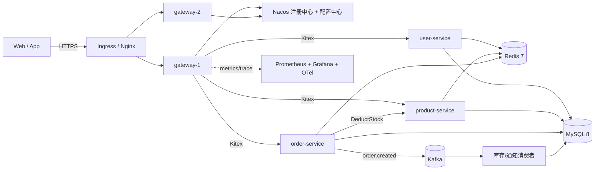
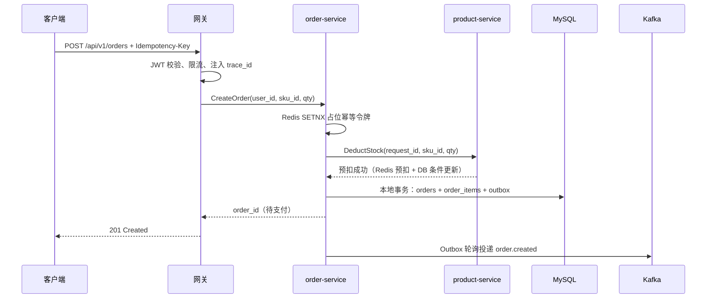

# 01-项目全景与架构设计
> 一句话定位：把前 12 章的知识点收束成一个有需求、有指标、有边界的 mall-lite，作为后续六篇的共同地基。

## 本篇目标

- 用一张需求表锁定 mall-lite 的业务范围与优先级
- 把 QPS / P99 / SLA 翻译成部署规格与容量参数
- 画出部署架构与下单时序，明确三个 RPC 服务的边界
- 定下仓库布局、接口清单、统一响应、错误码与环境规划，并用一份 compose 拉起全部依赖

## 前置知识

- Go Module 与单仓多包：[01-Go语言基础/08-包管理与项目结构](../01-Go语言基础/08-包管理与项目结构.md)
- hz 生成的项目结构与分层：[07-工程化与测试/01-项目分层与目录规范](../07-工程化与测试/01-项目分层与目录规范.md)
- Hertz 路由分组与中间件：[03-基本特性/05-中间件](../03-基本特性/05-中间件.md)；本机已装 Docker Desktop 与 Go 1.25

## 一、业务需求

mall-lite 只做“能讲清架构”的最小电商闭环，优惠券、退款、多仓、搜索推荐明确不做：

| 优先级 | 功能 | 说明 | 关键工程点 |
| --- | --- | --- | --- |
| P0 | 商品浏览 | 列表 + 详情，含价格与库存展示 | 缓存、空值缓存、击穿保护 |
| P0 | 注册登录 | 手机号/邮箱注册、密码登录、刷新令牌 | bcrypt、JWT、防重放 |
| P0 | 下单 | 选 SKU 与数量，生成待支付订单 | 幂等、预扣库存、事务 |
| P0 | 订单查询 | 单条详情 + 分页列表 | 缓存、读写分离 |
| P1 | 超时取消 | 30 分钟未支付自动关单并回补库存 | 延迟消息 + 定时兜底 |
| P1 | 支付回调 | 模拟支付成功，订单转已支付 | 幂等、状态机 |
| P2 | 订单通知 | SSE 推送订单状态变化 | 流式响应、连接治理 |

## 二、非功能需求

| 指标 | 目标值 | 验收方式 |
| --- | --- | --- |
| 峰值 QPS | 读 2000、写 200（读写比 10:1） | wrk / k6 压测 + 网关指标 |
| P99 延迟 | 网关 50ms、商品详情 30ms、下单 300ms | Prometheus Histogram |
| 可用性 | 99.95%，月停机 ≤ 21.6 分钟 | 多副本 + 滚动发布 + 演练 |
| 数据可靠性 | 订单/库存 RPO≈0，RTO ≤ 30min | 半同步复制 + 备份恢复演练 |
| 一致性 | 不超卖、不重复下单、最终一致 | 对账任务 + 幂等回归用例 |
| 安全 | 全站 HTTPS、access token 15min、密码 bcrypt | 安全扫描 + 渗透测试 |

用利特尔法则把指标换算成容量（并发 = QPS × 平均耗时）：读 `2000 × 30ms = 60` 并发，写 `200 × 300ms = 60` 并发；按单实例 800 QPS 且留 50% 余量，gateway 与 product-service 各 4 副本；MySQL 单服务连接池 50，总量压在 `max_connections` 的 60% 以内。

## 三、整体架构

部署视图：



下单主链路（细节见 [04-订单服务与下单主链路](04-订单服务与下单主链路.md)）：



## 四、模块划分与边界

| 模块 | 协议 | 职责 | 不该做什么 |
| --- | --- | --- | --- |
| gateway | HTTP/JSON、SSE | 鉴权、限流、聚合、协议转换、灰度 | 不直连 MySQL，不写业务状态 |
| user-service | Kitex RPC + 内部 HTTP | 注册、登录、用户资料、令牌 | 不处理订单与库存 |
| product-service | Kitex RPC | 商品、价格、库存预扣与回补 | 不感知订单状态 |
| order-service | Kitex RPC | 订单状态机、下单编排、Outbox | 不直接改库存表 |
| pkg | 库 | 配置、日志、错误码、Redis/DB 封装 | 不 import 任何 services 包 |

原则：**跨服务只认 IDL，跨服务不共享表**。order-service 需要商品信息时调 product-service，而不是 join products 表。

## 五、仓库布局（单仓多服务）

```text
mall-lite/
├── api/gateway/v1/api.proto        # HTTP 契约（hz 生成网关骨架）
├── idl/{user,product,order}.thrift # RPC 契约，唯一事实来源
├── services/
│   ├── gateway/{cmd,internal/{router,middleware,handler,client}}
│   ├── user/{cmd/api,cmd/rpc,internal/{handler,rpc,service,repository,model},kitex_gen}
│   ├── product/{cmd/rpc,internal/{rpc,service,repository,model},kitex_gen}
│   └── order/{cmd/rpc,internal/{rpc,service,repository,model},kitex_gen}
├── pkg/{config,errcode,response,jwtx,redisx,dbx,logx,idgen,outbox}
├── deploy/{docker-compose.yml,mysql/init.sql,nacos,prometheus,grafana,k8s}
├── scripts/{gen.sh,gen.ps1,migrate.sh}
├── go.work                          # 仅本地联调
└── go.mod                           # module mall-lite
```

实施顺序刻意与目录一致：先在 `user` 打通 Hz + Kitex 双协议（第 02 篇），再补 `product`（第 03 篇）与 `order`（第 04 篇），最后把网关能力补齐（第 05 篇）。

## 六、接口清单

| 方法 | 路径 | 鉴权 | 说明 | 后端 |
| --- | --- | --- | --- | --- |
| POST | `/api/v1/auth/register` | 否 | 注册 | user-service |
| POST | `/api/v1/auth/login` | 否 | 登录，返回 access/refresh | user-service |
| POST | `/api/v1/auth/refresh` | refresh | 刷新 access token | user-service |
| GET | `/api/v1/users/me` | 是 | 当前用户资料 | user-service |
| PATCH | `/api/v1/users/me` | 是 | 更新昵称/头像 | user-service |
| GET | `/api/v1/products` | 否 | 商品列表（分页） | product-service |
| GET | `/api/v1/products/:id` | 否 | 商品详情（含库存展示） | product-service |
| POST | `/api/v1/orders` | 是 | 下单（需 Idempotency-Key） | order-service |
| GET | `/api/v1/orders/:id` | 是 | 订单详情（仅本人） | order-service |
| GET | `/api/v1/orders` | 是 | 我的订单列表 | order-service |
| POST | `/api/v1/orders/:id/pay` | 是 | 模拟支付回调 | order-service |
| POST | `/api/v1/orders/:id/cancel` | 是 | 主动取消 | order-service |
| GET | `/api/v1/orders/stream` | 是 | SSE 订单状态推送 | gateway |

内部 Kitex 接口不对公网暴露：`GetProduct`、`DeductStock`、`RestoreStock`、`GetStock`、`CreateOrder`、`CancelOrder`、`GetUser`。

## 七、统一响应与错误码

所有 HTTP 响应使用同一信封，状态码只表达传输语义，业务结果看 `code`：`{"code":0,"msg":"ok","data":{"order_id":1001},"trace_id":"9f2c1e7a"}`。

```go
package response

import (
	"github.com/cloudwego/hertz/pkg/app"
	"github.com/cloudwego/hertz/pkg/protocol/consts"
)

type Body struct {
	Code    int         `json:"code"`
	Msg     string      `json:"msg"`
	Data    interface{} `json:"data,omitempty"`
	TraceID string      `json:"trace_id,omitempty"`
}

func OK(c *app.RequestContext, data interface{}) {
	c.JSON(consts.StatusOK, Body{Code: 0, Msg: "ok", Data: data, TraceID: string(c.GetHeader("X-Trace-Id"))})
}

func Fail(c *app.RequestContext, httpStatus, code int, msg string) {
	c.AbortWithStatusJSON(httpStatus, Body{Code: code, Msg: msg, TraceID: string(c.GetHeader("X-Trace-Id"))})
}
```

错误码分段，前端按段做兜底，不依赖文案：

| 区间 | 归属 | 示例 |
| --- | --- | --- |
| 0 | 成功 | 0 |
| 10xxx | 用户/认证 | 10001 参数非法、10002 已注册、10003 密码错误、10004 token 过期 |
| 20xxx | 商品/库存 | 20001 商品不存在、20002 库存不足、20003 重复请求 |
| 30xxx | 订单 | 30001 订单不存在、30002 状态不允许、30003 重复下单 |
| 40xxx | 网关 | 40001 未登录、40002 限流、40003 重放、40004 灰度无可用实例 |
| 50xxx | 系统 | 50000 内部错误、50001 下游超时、50002 依赖不可用 |

映射规则：参数错误 → 400，未登录 → 401，无权限/非本人 → 403，不存在 → 404，状态冲突 → 409，限流 → 429，超时 → 504，其余 → 500。

## 八、环境规划

| 项 | dev | test | prod |
| --- | --- | --- | --- |
| 副本数 | 1 | 1 | gateway 4、业务 3 |
| MySQL | 容器单实例 | 单实例 + 每日备份 | 主从 + 半同步 |
| Redis | 单实例 | 主从 | Cluster 或哨兵 |
| Kafka | 单 Broker（KRaft） | 3 Broker | 3 Broker + 副本 2 |
| 配置来源 | 本地 yaml | Nacos dev 命名空间 | Nacos prod 命名空间 |
| 数据初始化 | `deploy/mysql/init.sql` | 迁移脚本 | 迁移脚本 + 审批 |

## 九、本地一键起依赖

`deploy/docker-compose.yml` 只放基础设施，业务服务用 `go run` 起，便于调试：

```yaml
services:
  mysql:
    image: mysql:8.0.36
    command: --character-set-server=utf8mb4 --collation-server=utf8mb4_unicode_ci
    environment: {MYSQL_ROOT_PASSWORD: root123, MYSQL_DATABASE: mall, TZ: Asia/Shanghai}
    ports: ["3306:3306"]
    volumes: ["./mysql/init.sql:/docker-entrypoint-initdb.d/init.sql:ro", "mysql-data:/var/lib/mysql"]
  redis:
    image: redis:7.2-alpine
    command: ["redis-server", "--appendonly", "yes"]
    ports: ["6379:6379"]
    volumes: ["redis-data:/data"]
  kafka:
    image: bitnami/kafka:3.7.0
    ports: ["9092:9092"]
    environment:
      KAFKA_CFG_NODE_ID: 0
      KAFKA_CFG_PROCESS_ROLES: controller,broker
      KAFKA_CFG_CONTROLLER_QUORUM_VOTERS: 0@kafka:9093
      KAFKA_CFG_LISTENERS: PLAINTEXT://:9092,CONTROLLER://:9093
      KAFKA_CFG_ADVERTISED_LISTENERS: PLAINTEXT://127.0.0.1:9092
      KAFKA_CFG_CONTROLLER_LISTENER_NAMES: CONTROLLER
  nacos:
    image: nacos/nacos-server:v2.3.2
    environment: {MODE: standalone, NACOS_AUTH_ENABLE: "false", JVM_XMS: 512m, JVM_XMX: 512m}
    ports: ["8848:8848", "9848:9848"]

volumes:
  mysql-data:
  redis-data:
```

```bash
docker compose -f deploy/docker-compose.yml up -d
docker compose -f deploy/docker-compose.yml ps
```

## 十、开发启动顺序

依赖先起，再按“被依赖方优先”启动，避免网关启动时 Nacos 里没有实例：

```bash
docker compose -f deploy/docker-compose.yml up -d   # 0. 基础设施
bash scripts/gen.sh                                  # 1. IDL 改动后生成代码
go run ./services/user/cmd/rpc -conf deploy/config/user-local.yaml
go run ./services/product/cmd/rpc -conf deploy/config/product-local.yaml
go run ./services/order/cmd/rpc -conf deploy/config/order-local.yaml
go run ./services/gateway/cmd -conf deploy/config/gateway-local.yaml
curl "http://127.0.0.1:8080/api/v1/products?page=1&size=10"
```

PowerShell 下把 `bash scripts/gen.sh` 换成 `powershell -File scripts/gen.ps1`，`curl` 换成 `curl.exe`。

## 常见坑

1. **先写代码再定契约**：字段名在三个服务里各叫一套，最后只能靠 DTO 硬转。先把 `idl/*.thrift` 与接口清单冻结一版，改动走评审。
2. **把 QPS 当 TPS**：忽略读写比与调用放大（一次下单 3 次 RPC、2 次 DB），容量算出来偏小一半。
3. **容器内用 `127.0.0.1` 连依赖**：Kafka 的 `ADVERTISED_LISTENERS` 必须写宿主机可达地址，否则业务进程连得上 Broker 却收不到元数据。
4. **错误码只有 200/500**：前端无法区分“库存不足”和“系统错误”，只能弹通用报错，体验与排障双输。
5. **时区不一致**：MySQL、容器、Go 进程时区不同，30 分钟超时判定会漂移；统一 `TZ=Asia/Shanghai`，时间列用 `DATETIME(3)`。
6. **Nacos 注册了容器 IP**：容器化后要确保注册地址是 Pod IP 且端口与 Service 一致，否则网关拿到不可达地址，重试也救不回来。

## 小结

- mall-lite 的范围是“浏览 → 登录 → 下单 → 查单 → 超时取消”，其余一律延后
- 非功能指标要能换算成副本数、连接池与缓存容量，否则只是口号
- 三个 RPC 服务按“用户 / 商品库存 / 订单”切，跨服务只走 IDL，不共享表
- 统一响应信封 + 分段错误码，是后续网关、可观测性与排障的共同语言
- 本地依赖用 compose 一键起，业务进程用 `go run`，调试成本最低

## 练习

1. 把本文的接口清单补上请求/响应字段，写进 `api/gateway/v1/api.proto` 并跑通 `hz update`。
2. 用利特尔法则重算：若 P99 下单耗时涨到 500ms、峰值写 QPS 300，需要几个 order-service 副本？
3. 给错误码表补三个你业务里真实会遇到的错误，并说明对应的 HTTP 状态码与前端兜底文案。

## 相关章节

- 下一篇：[02-用户服务Hertz与Kitex落地](02-用户服务Hertz与Kitex落地.md)
- [07-工程化与测试/01-项目分层与目录规范](../07-工程化与测试/01-项目分层与目录规范.md)
- [09-MySQL与ORM最佳实践/02-GORM核心用法与模型设计](../09-MySQL与ORM/02-GORM核心用法与模型设计.md)
- [10-Redis缓存最佳实践/02-缓存模式与三大经典问题](../10-Redis/02-缓存模式与三大经典问题.md)
- [12-微服务与Kitex/01-Hertz加Kitex的微服务架构](../12-微服务与Kitex/01-Hertz加Kitex的微服务架构.md)
- 返回 [教程总目录](../README.md)
