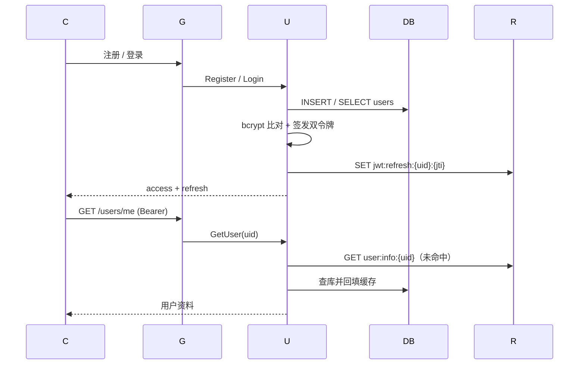

# 02-用户服务Hertz与Kitex落地
> 一句话定位：从一份 user.thrift 同时长出 HTTP 与 RPC 两层，跑通注册、登录、带 token 查询的闭环。

## 本篇目标

- 用一份 IDL 同时驱动 hz 与 kitex，避免两套契约漂移
- 落地 handler → service → repository 分层与 users 表
- 用 bcrypt 存密码，JWT 双令牌签发/轮换，Redis 缓存用户信息
- 统一参数校验与错误码，掌握单测要点，并画出完整请求链路

## 前置知识

- 已读 [01-项目全景与架构设计](01-项目全景与架构设计.md)，了解仓库布局与错误码
- 分层与依赖方向：[07-工程化与测试/01-项目分层与目录规范](../07-工程化与测试/01-项目分层与目录规范.md)
- Hertz 参数绑定与校验：[03-基本特性/03-参数绑定与校验](../03-基本特性/03-参数绑定与校验.md)；Kitex IDL 与生成：[12-微服务与Kitex/02-Kitex快速入门与IDL](../12-微服务与Kitex/02-Kitex快速入门与IDL.md)

## 一、双协议、一个内核

user-service 同时暴露两种入口：网关用 Kitex 调用，运营后台与健康检查走 HTTP。两条入口共享 service 层，业务规则只写一遍。

```text
services/user/
├── cmd/{api,rpc}/main.go   # Hertz :8081 / Kitex :9001
├── internal/{handler,rpc}/ # HTTP 与 RPC 适配，只做协议转换
├── internal/{service,repository,model}/
├── kitex_gen/user/         # 生成代码，禁止手改
└── conf/user.yaml
```

`service` 决定事务与业务规则，`repository` 不返回 HTTP 状态码。

## 二、先定 user.thrift

```thrift
namespace go user

struct User {
  1: i64 id
  2: string email
  3: string nickname
  4: string avatar
  5: i64 created_at
}
struct RegisterReq   { 1: string email, 2: string password, 3: string nickname }
struct RegisterResp  { 1: i64 user_id }
struct LoginReq      { 1: string email, 2: string password }
struct LoginResp     { 1: string access_token, 2: string refresh_token, 3: i64 expires_in }
struct GetUserReq    { 1: i64 user_id }
struct UpdateUserReq { 1: i64 user_id, 2: optional string nickname, 3: optional string avatar }
exception BizError   { 1: i32 code, 2: string message }

service UserService {
  RegisterResp Register(1: RegisterReq req) throws (1: BizError e)
  LoginResp Login(1: LoginReq req) throws (1: BizError e)
  User GetUser(1: GetUserReq req) throws (1: BizError e)
  User UpdateUser(1: UpdateUserReq req) throws (1: BizError e)
}
```

字段只增不改序号；密码、token 只出现在请求/响应结构里，绝不进入 `User`。生成命令收进脚本：

```bash
hz new -module mall-lite -idl idl/user.thrift   # HTTP 骨架，生成后按第 07 章迁移
kitex -module mall-lite -service user-service idl/user.thrift  # RPC 骨架
```

每次重新生成都要 review diff，防止手写逻辑被覆盖。

## 三、users 表与 GORM 模型

```sql
CREATE TABLE users (
  id BIGINT UNSIGNED NOT NULL AUTO_INCREMENT,
  email VARCHAR(128) NOT NULL,
  password_hash VARCHAR(72) NOT NULL,
  nickname VARCHAR(32) NOT NULL DEFAULT '',
  status TINYINT NOT NULL DEFAULT 1 COMMENT '1 正常 0 禁用',
  created_at DATETIME(3) NOT NULL DEFAULT CURRENT_TIMESTAMP(3),
  updated_at DATETIME(3) NOT NULL DEFAULT CURRENT_TIMESTAMP(3) ON UPDATE CURRENT_TIMESTAMP(3),
  PRIMARY KEY (id), UNIQUE KEY uk_email (email)
) ENGINE=InnoDB DEFAULT CHARSET=utf8mb4;
```

```go
type User struct {
	ID           int64  `gorm:"column:id;primaryKey"`
	Email        string `gorm:"column:email;size:128;uniqueIndex"`
	PasswordHash string `gorm:"column:password_hash;size:72"`
	Nickname     string `gorm:"column:nickname;size:32"`
	Status       int8   `gorm:"column:status"`
	CreatedAt    time.Time
	UpdatedAt    time.Time
}

func (User) TableName() string { return "users" }
```

`gorm.Open` 时开启 `gorm.Config{TranslateError: true}`，唯一键冲突变成 `gorm.ErrDuplicatedKey`，不必解析驱动错误码。

## 四、repository：只认接口

```go
type UserRepository interface {
	Create(ctx context.Context, u *model.User) error
	FindByEmail(ctx context.Context, email string) (*model.User, error)
	FindByID(ctx context.Context, id int64) (*model.User, error)
	UpdateProfile(ctx context.Context, id int64, nickname, avatar string) error
}

func (r *gormUserRepo) FindByID(ctx context.Context, id int64) (*model.User, error) {
	var u model.User
	err := r.db.WithContext(ctx).First(&u, id).Error
	if errors.Is(err, gorm.ErrRecordNotFound) {
		return nil, nil // 交给 service 决定业务错误
	}
	return &u, err
}
```

`UpdateProfile` 用 `Updates(map[string]any{...})` 并带 `WHERE id = ? AND status = 1`，避免把禁用用户改活；影响行数为 0 视为未找到。

## 五、service：注册与登录

```go
func (s *userService) Register(ctx context.Context, email, pwd, nickname string) (int64, error) {
	hash, err := bcrypt.GenerateFromPassword([]byte(pwd), s.bcryptCost) // 生产 cost=12
	if err != nil {
		return 0, fmt.Errorf("hash password: %w", err)
	}
	u := &model.User{Email: strings.ToLower(email), PasswordHash: string(hash), Nickname: nickname, Status: 1}
	if err := s.repo.Create(ctx, u); err != nil {
		if errors.Is(err, gorm.ErrDuplicatedKey) {
			return 0, ErrEmailExists
		}
		return 0, err
	}
	return u.ID, nil
}
```

登录三件事：查不到用户与密码错误返回**同一错误**（防枚举）、`bcrypt.CompareHashAndPassword` 只在查到用户后执行、成功后签双令牌。bcrypt 输入上限 72 字节，注册入口必须先校验长度。

## 六、JWT 双令牌与刷新

```go
type Claims struct {
	UserID int64  `json:"uid"`
	Type   string `json:"typ"` // access | refresh
	jwt.RegisteredClaims
}

func issue(uid int64, secret []byte, typ string, ttl time.Duration) (string, error) {
	claims := Claims{UserID: uid, Type: typ, RegisteredClaims: jwt.RegisteredClaims{
		Subject: strconv.FormatInt(uid, 10), ID: uuid.NewString(), Issuer: "mall-lite",
		IssuedAt: jwt.NewNumericDate(time.Now()), ExpiresAt: jwt.NewNumericDate(time.Now().Add(ttl)),
	}}
	return jwt.NewWithClaims(jwt.SigningMethodHS256, claims).SignedString(secret)
}
```

校验时用 `jwt.ParseWithClaims` 并固定 `HS256`，拒绝 `alg=none` 与 RS/HS 混用。

access 15 分钟、refresh 7 天。签发 refresh 时把 `jwt:refresh:{uid}:{jti}` 写入 Redis；`/auth/refresh` 校验通过后删除旧 jti 再签新对，旧令牌立即失效。密钥来自 Nacos 或 `JWT_SECRET`，长度 ≥ 32 字节。

## 七、Redis 缓存用户信息

key 为 `user:info:{id}`，value 是 JSON，TTL 30 分钟 ± 5 分钟随机抖动，避免同时失效：

```go
func (s *userService) Get(ctx context.Context, id int64) (*model.User, error) {
	key := fmt.Sprintf("user:info:%d", id)
	var u model.User
	if b, err := s.rdb.Get(ctx, key).Bytes(); err == nil && json.Unmarshal(b, &u) == nil {
		return &u, nil
	}
	u, err := s.repo.FindByID(ctx, id)
	if err != nil || u == nil {
		return u, err
	}
	if b, err := json.Marshal(u); err == nil {
		s.rdb.Set(ctx, key, b, 30*time.Minute+time.Duration(rand.Intn(600))*time.Second)
	}
	return u, nil
}
```

更新资料时**先改库再删缓存**（Cache-Aside），不要直接 set 新值，否则并发写会把旧值写回。缓存里不存 `PasswordHash`，单独定义 `userCache` DTO。

## 八、HTTP handler：绑定、校验、错误映射

```go
type RegisterReq struct {
	Email    string `json:"email" v:"required,email"`
	Password string `json:"password" v:"required,min=8,max=32"`
	Nickname string `json:"nickname" v:"required,min=1,max=20"`
}

func (h *Handler) Register(ctx context.Context, c *app.RequestContext) {
	var req RegisterReq
	if err := c.BindAndValidate(&req); err != nil {
		response.Fail(c, 400, errcode.InvalidParam, "参数不合法")
		return
	}
	id, err := h.svc.Register(ctx, req.Email, req.Password, req.Nickname)
	if errors.Is(err, service.ErrEmailExists) {
		response.Fail(c, 409, errcode.EmailExists, "邮箱已注册")
		return
	}
	if err != nil {
		response.Fail(c, 500, errcode.Internal, "系统繁忙")
		return
	}
	response.OK(c, map[string]int64{"user_id": id})
}
```

## 九、RPC 适配层

```go
func (s *UserServiceImpl) GetUser(ctx context.Context, req *user.GetUserReq) (*user.User, error) {
	u, err := s.svc.Get(ctx, req.UserId)
	if err != nil || u == nil {
		return nil, &user.BizError{Code: errcode.UserNotFound, Message: "用户不存在"}
	}
	return &user.User{Id: u.ID, Email: u.Email, Nickname: u.Nickname}, nil
}
```

启动时用 `user.NewServer` + `server.WithRegistry` 注册到 Nacos（见第 12 章）。RPC 层抛 `BizError` 而不是 `fmt.Errorf`，调用方才能拿到稳定错误码；系统错误才返回普通 error，交给熔断与重试判断。

## 十、完整请求链路



## 十一、单测要点

- service：mock `UserRepository`，覆盖已注册、重复键、bcrypt 失败、密码错误、禁用用户；bcrypt 用 `MinCost` 加速
- repository/handler：用 `go-sqlmock` 或 testcontainers 验证 `ErrRecordNotFound` 与唯一键映射；用 `ut.PerformRequest` 打路由断言状态码
- JWT：注入固定时钟，覆盖过期、篡改 payload、算法替换、refresh 重放四类用例

## 常见坑

1. **密码进日志或响应**：DTO 与实体不分，`json.Marshal(u)` 把 hash 吐给前端；缓存与响应各用独立 DTO。
2. **bcrypt 超长输入**：超过 72 字节会被静默截断，两个长密码可能等价；注册时限制长度。
3. **JWT 不校验算法**：只 `Parse` 不检查 `Method`，攻击者可伪造 `alg=none`；必须白名单固定 HS256。
4. **刷新令牌不轮换**：refresh 泄露后 7 天内可反复换新；每次刷新删除旧 jti 并留审计。
5. **注册并发绕过查重**：先 `SELECT` 再 `INSERT` 必翻车；最终靠唯一索引，服务层只把冲突翻译成 409。

## 小结

- 一份 thrift 同时生成 HTTP 与 RPC 骨架，业务规则沉到 service，两套协议只是薄适配
- users 表用唯一索引兜底并发注册，bcrypt cost 12，72 字节上限在入口校验
- access 15 分钟、refresh 7 天且每次轮换，JWT 校验必须固定签名算法
- 用户缓存 Cache-Aside + 随机 TTL，更新删缓存，缓存故障降级读库；错误从哨兵错误映射到统一错误码

## 练习

1. 给 `UpdateUserReq` 加 `version` 字段做乐观锁，要求并发更新返回 409 而不是覆盖。
2. 实现 `/auth/refresh`：校验 refresh 的 `typ`、删除旧 jti、签发新对令牌，并补一个重放测试。
3. 把 `GetUser` 的缓存改成 singleflight 回源，用 100 并发压测对比回源次数。

## 相关章节

- 上一篇：[01-项目全景与架构设计](01-项目全景与架构设计.md)
- 下一篇：[03-商品与库存服务](03-商品与库存服务.md)
- [10-Redis缓存最佳实践/02-缓存模式与三大经典问题](../10-Redis/02-缓存模式与三大经典问题.md)
- [12-微服务与Kitex/03-Kitex服务端最佳实践](../12-微服务与Kitex/03-Kitex服务端最佳实践.md)
