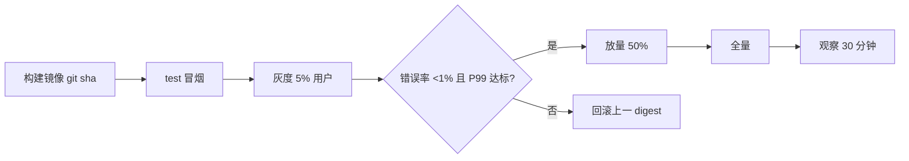

# 06-可观测性-部署与灰度
> 一句话定位：让每次发布都可观测、可灰度、可回滚，把“上线靠祈祷”变成一条可执行的流程。

## 本篇目标

- 建立框架指标 + 业务指标 + 资源指标三层观测体系
- 用 Prometheus/Grafana 配出 QPS、错误率、P99 与业务漏斗看板
- 用 OpenTelemetry 串起 Hertz → Kitex → MySQL/Redis/Kafka
- 写多阶段 Dockerfile 与 K8s Deployment/Service/HPA，配好三类探针
- 固化“构建 → 冒烟 → 灰度 → 全量 → 回滚”的发布流程与检查清单

## 前置知识

- 已读 [05-网关鉴权与限流](05-网关鉴权与限流.md)，网关已有 trace_id 与统一日志
- Hertz 监控扩展：[05-治理与扩展/05-监控扩展Prometheus](../05-治理与扩展/05-监控扩展Prometheus.md)
- 链路追踪与 Docker/K8s：[04-可观测性/02-链路追踪OpenTelemetry与Skywalking](../04-可观测性/02-链路追踪OpenTelemetry与Skywalking.md)、[08-部署与运维/03-Kubernetes部署与健康检查](../08-部署与运维/03-Kubernetes部署与健康检查.md)

## 一、三层指标

| 层 | 指标 | 用途 |
| --- | --- | --- |
| 框架 | `hertz_server_throughput`、`hertz_server_latency_us` | 入口 QPS/延迟/状态码 |
| 框架 | `kitex_server_*`、`kitex_client_*` | RPC 成功率与耗时（示例示意，以版本为准） |
| 业务 | `order_created_total`、`order_paid_total`、`stock_deduct_fail_total` | 漏斗与失败归因 |
| 业务 | `outbox_pending`、`kafka_consumer_lag` | 异步链路健康度 |
| 资源 | 容器 CPU/内存、DB 连接池、Redis 命中率 | 容量与瓶颈 |

```go
var orderCreated = prometheus.NewCounterVec(prometheus.CounterOpts{
	Name: "order_created_total", Help: "创建的订单数",
}, []string{"status"})

func init() { prometheus.MustRegister(orderCreated) }

// 下单成功后：orderCreated.WithLabelValues("pending").Inc()
```

Hertz 用 `monitor-prometheus` 的 `NewServerTracer(":9091", "/hertz")`；Kitex 用 `monitor-prometheus` 的 tracer 挂到 `server.WithTracer(...)`（Kitex 侧 API 以所用版本为准，示例示意）。指标端口独立于业务端口，禁止对公网暴露。

## 二、Grafana 看板

每个服务固定四块：流量、错误、延迟、饱和度；再加两张业务大盘：下单漏斗、异步链路。

```promql
# QPS
sum(rate(hertz_server_throughput[1m])) by (service)
# 错误率
sum(rate(hertz_server_throughput{statusCode=~"5.."}[5m])) / sum(rate(hertz_server_throughput[5m]))
# P99（微秒转毫秒）
histogram_quantile(0.99, sum(rate(hertz_server_latency_us_bucket[5m])) by (le, service)) / 1000
# 库存扣减失败率
sum(rate(stock_deduct_fail_total[5m])) / sum(rate(order_created_total[5m]))
# Outbox 积压
max(outbox_pending)
```

看板顶部放 SLO 摘要（可用性、P99 达标率），下面按服务下钻；每张图必须能回答“哪个服务、哪个接口、从什么时候开始坏”。

## 三、OpenTelemetry 全链路

```go
p, _ := provider.NewOpenTelemetryProvider(
	provider.WithServiceName("api-gateway"),
	provider.WithExportEndpoint("otel-collector:4317"),
	provider.WithInsecure(),
)
defer p.Shutdown(context.Background())

h := server.Default(server.WithTracer(tracing.NewServerTracer()))
h.Use(tracing.ServerMiddleware())
```

Kitex 服务端 `server.WithSuite(tracing.NewServerSuite())`，客户端 `client.WithSuite(tracing.NewClientSuite())`，两侧使用 W3C `tracecontext` 传播。网关把 `trace_id` 写进响应头与日志，用户报障时提供一个 ID 就能串起网关、RPC、SQL 与 Kafka 消费。采样策略：默认 1% 头部采样，错误与慢请求（>1s）在 Collector 侧尾部采样全留。

## 四、日志规范

- 结构化 JSON：`ts/level/service/trace_id/span_id/request_id/uid/msg/error`
- 只写 stdout，由 DaemonSet 采集到 Loki/ES；容器内不落业务日志文件
- 敏感字段白名单：禁止打印密码、token、完整手机号、请求体
- 错误日志必须带 `error` 与关键业务键（order_no、sku_id），方便聚合
- 日志级别可经 Nacos 动态调整，排障时临时开 debug，事后恢复

## 五、告警规则

```yaml
groups:
  - name: mall-slo
    rules:
      - alert: HighErrorRate
        expr: sum(rate(hertz_server_throughput{statusCode=~"5.."}[5m])) / sum(rate(hertz_server_throughput[5m])) > 0.01
        for: 5m
        labels: { severity: critical }
        annotations: { summary: "5xx 错误率 > 1%" }
      - alert: HighP99
        expr: histogram_quantile(0.99, sum(rate(hertz_server_latency_us_bucket[5m])) by (le)) > 300000
        for: 10m
        labels: { severity: warning }
        annotations: { summary: "入口 P99 > 300ms" }
      - alert: KafkaLag
        expr: sum(kafka_consumer_lag) by (group) > 10000
        for: 10m
        labels: { severity: warning }
```

补三条业务告警：`stock_deduct_fail_total` 5 分钟突增 10 倍（可能超卖或恶意刷单）、`outbox_pending > 1000` 且最老事件 > 5 分钟（消息投递卡住）、Pod 重启次数 > 3/小时（崩溃循环）。每条告警必须有 Runbook 链接与值班人，否则就是噪音。

## 六、Docker 多阶段镜像

```dockerfile
FROM golang:1.25-alpine AS build
WORKDIR /src
COPY go.mod go.sum ./
RUN go mod download
COPY . .
RUN CGO_ENABLED=0 GOOS=linux go build -trimpath -ldflags="-s -w" \
    -o /out/gateway ./services/gateway/cmd

FROM gcr.io/distroless/static-debian12:nonroot
COPY --from=build /out/gateway /app
USER nonroot:nonroot
EXPOSE 8080
ENTRYPOINT ["/app"]
```

镜像 tag 用 `git sha`，禁用 `latest`；基础镜像固定 digest，构建参数 `-trimpath` 去掉本机路径。distroless 没有 shell，健康检查只能靠 HTTP 探针，这也逼着服务把 `/healthz` 做对。

## 七、Kubernetes 部署

```yaml
apiVersion: apps/v1
kind: Deployment
metadata: { name: gateway }
spec:
  replicas: 3
  strategy: { rollingUpdate: { maxUnavailable: 0, maxSurge: 1 } }
  selector: { matchLabels: { app: gateway } }
  template:
    metadata: { labels: { app: gateway } }
    spec:
      terminationGracePeriodSeconds: 30
      containers:
        - name: gateway
          image: registry.example.com/mall/gateway:${GIT_SHA}
          ports: [{ containerPort: 8080 }]
          envFrom: [{ configMapRef: { name: gateway-config } }]
          resources:
            requests: { cpu: "500m", memory: "256Mi" }
            limits:   { cpu: "2", memory: "512Mi" }
          readinessProbe:
            httpGet: { path: /readyz, port: 8080 }
            periodSeconds: 5
          livenessProbe:
            httpGet: { path: /healthz, port: 8080 }
            periodSeconds: 10
          startupProbe:
            httpGet: { path: /healthz, port: 8080 }
            failureThreshold: 30
            periodSeconds: 2
---
apiVersion: v1
kind: Service
metadata: { name: gateway }
spec:
  selector: { app: gateway }
  ports: [{ name: http, port: 80, targetPort: 8080 }]
---
apiVersion: autoscaling/v2
kind: HorizontalPodAutoscaler
metadata: { name: gateway }
spec:
  scaleTargetRef: { apiVersion: apps/v1, kind: Deployment, name: gateway }
  minReplicas: 3
  maxReplicas: 12
  metrics:
    - type: Resource
      resource: { name: cpu, target: { type: Utilization, averageUtilization: 65 } }
```

HPA 用 CPU 65% 只是起点；下单服务更该看 QPS 或 P99（需 Prometheus Adapter）。`maxUnavailable: 0` 保证滚动发布不掉容量，配合 `terminationGracePeriodSeconds` 与 preStop 延迟摘流量，避免正在处理的请求被硬杀。

## 八、健康检查与优雅退出

- `/healthz` 只证明进程活着，不查 DB/Redis，防止依赖抖动引发批量重启
- `/readyz` 检查 DB ping 与注册中心状态，失败即摘除 Endpoint，不接新流量
- `startupProbe` 给慢启动兜底，启动成功后才启用 liveness
- Hertz 用 `server.WithExitWaitTime(10*time.Second)`，在 `OnShutdown` 里关闭 Kitex 客户端与 Kafka writer
- Kitex 服务监听 SIGTERM 调 `svr.Stop()`；探针由独立 HTTP 端口提供（示例示意）

## 九、发布流程与回滚



发布顺序：先 DB 迁移（只加不删，兼容旧版）→ 无状态服务 → 网关。回滚用 `kubectl rollout undo` 或直接指向旧 digest；涉及数据结构时用“扩展-收缩”两次发布，禁止在同一版里既加列又删列。功能开关优先于回滚，能关就别发。

## 十、发布检查清单

- [ ] 镜像 digest 固定、tag 对应 commit，镜像扫描无高危
- [ ] 配置与密钥已写入对应环境，未提交到仓库
- [ ] DB 迁移可向前兼容，回滚不需要改数据
- [ ] 新接口有超时、重试上限与降级策略
- [ ] 看板与告警已覆盖新服务/新接口
- [ ] 容量评估完成，HPA 与连接池上限匹配
- [ ] 灰度名单、观察指标、回滚命令已就绪
- [ ] 值班人与变更窗口确认，发布后 30 分钟观察

## 常见坑

1. **liveness 查 DB**：DB 抖动导致全量 Pod 重启，故障放大；存活与就绪必须分开。
2. **指标标签带 user_id/order_no**：基数爆炸拖垮 Prometheus；标签只放低基数维度。
3. **日志写容器文件**：Pod 重建即丢；统一 stdout 采集。
4. **HPA 只看 CPU**：IO 密集服务扩不出来；用 QPS/P99 自定义指标。
5. **滚动发布 maxUnavailable>0**：高峰期容量瞬时不足；核心服务设为 0。
6. **回滚依赖重建镜像**：构建链一坏就回不去；保留历史 digest 并演练回滚。

## 小结

- 观测三层：框架 RED、业务漏斗、资源饱和度，缺一层就会盲人摸象
- trace_id 贯穿 HTTP、RPC、SQL 与消息，日志、指标、链路可互相跳转
- 告警只留可行动的规则，每条都要有 Runbook 与值班人
- 镜像不可变、探针分离、优雅退出，是 K8s 上稳定运行的三件套
- 发布以灰度为默认，回滚要演练到“一条命令完成”

## 练习

1. 给 order-service 加 `order_created_total{status}`，在 Grafana 画出“创建 → 支付 → 取消”漏斗。
2. 写一条 Outbox 积压告警，要求能区分“投递失败”和“消费滞后”，并给出排查步骤。
3. 用 kind 起一个集群，部署网关与 HPA，压测触发扩容，再演练一次 `rollout undo`。

## 相关章节

- 上一篇：[05-网关鉴权与限流](05-网关鉴权与限流.md)
- 下一篇：[07-复盘与演进](07-复盘与演进.md)
- [04-可观测性/02-链路追踪OpenTelemetry与Skywalking](../04-可观测性/02-链路追踪OpenTelemetry与Skywalking.md)
- [05-治理与扩展/05-监控扩展Prometheus](../05-治理与扩展/05-监控扩展Prometheus.md)
- [08-部署与运维/02-Docker镜像与多阶段构建](../08-部署与运维/02-Docker镜像与多阶段构建.md)
- [08-部署与运维/03-Kubernetes部署与健康检查](../08-部署与运维/03-Kubernetes部署与健康检查.md)
